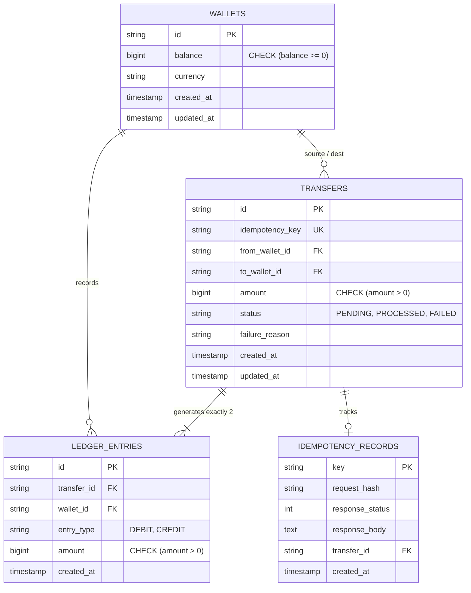
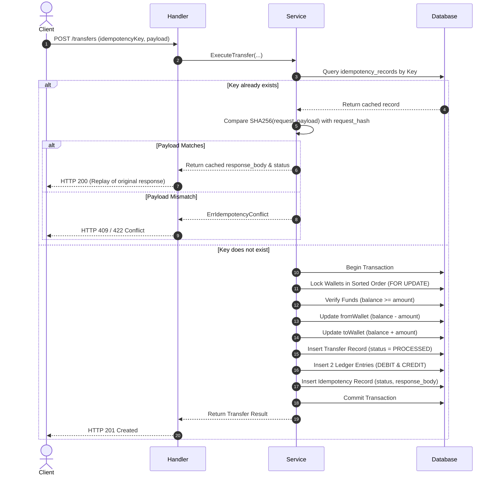

# Wallet Transfer Service — Architecture & Technical Approach (RFC)

**Candidate:** Safeek  
**Target Role:** Backend SDE 3  
**Status:** In Review / Proposal (Pre-Implementation RFC)  
**Submission Date:** October 2026  

---

## 1. Executive Summary

This document details the architectural design, schema modeling, concurrency control strategy, and idempotency guarantees for the **Wallet Transfer Service**. 

The primary requirement is to execute wallet-to-wallet transfers reliably in a distributed environment where network timeouts, retries, concurrent balance mutations, and unexpected failures are standard operating conditions.

Key system attributes:
* **Double-Entry Bookkeeping:** Every monetary movement generates two balanced, immutable ledger entries.
* **API-Level Idempotency:** Exactly-once semantics enforced via durable database constraints and request hashing.
* **Deadlock-Free Concurrency Control:** Row-level pessimistic locking (`SELECT ... FOR UPDATE`) with deterministic resource ordering.
* **ACID Transaction Boundaries:** Strict atomic updates combining wallet balances, ledger entries, transfer records, and idempotency entries.
* **Clean Layered Architecture:** Strict decoupling between Transport (Handlers), Domain Logic (Service), and Data Persistence (Repository).

---

## 2. API Contract

### Create Transfer Endpoint
* **Path:** `POST /transfers`
* **Headers:** `Content-Type: application/json`

#### Request Payload
```json
{
  "idempotencyKey": "9b1deb4d-3b7d-4bad-9bdd-2b0d7b3dcb6d",
  "fromWalletId": "w_user_101",
  "toWalletId": "w_user_202",
  "amount": 2500
}
```

*Notes on Payload Validation:*
* `amount`: Stored as an integer in the smallest currency unit (e.g., cents, paise, or satoshis) to eliminate IEEE-754 floating-point inaccuracies. Must be strictly positive ($> 0$).
* `fromWalletId != toWalletId`: Self-transfers are rejected at the handler validation layer.
* `idempotencyKey`: Non-empty string (UUID v4 or client token, max 255 chars).

#### Response Payload (HTTP 201 Created / 200 OK for replays)
```json
{
  "transferId": "tr_8f9a2b1c",
  "idempotencyKey": "9b1deb4d-3b7d-4bad-9bdd-2b0d7b3dcb6d",
  "fromWalletId": "w_user_101",
  "toWalletId": "w_user_202",
  "amount": 2500,
  "status": "PROCESSED",
  "createdAt": "2026-10-23T12:00:00Z"
}
```

#### Error Responses
* `400 Bad Request`: Validation failure (negative amount, identical source & destination, missing fields).
* `404 Not Found`: Source or destination wallet does not exist.
* `409 Conflict / 422 Unprocessable Entity`: Insufficient funds, or idempotency key reused with a conflicting payload.
* `500 Internal Server Error`: Unhandled database error or unexpected system failure.

---

## 3. Database Schema Design (PostgreSQL / SQLite Compatible)

### 3.1 Entity Relationship Overview



### 3.2 Table Definitions & Constraints

```sql
-- 1. Wallets
CREATE TABLE wallets (
    id VARCHAR(64) PRIMARY KEY,
    balance BIGINT NOT NULL DEFAULT 0 CHECK (balance >= 0),
    currency VARCHAR(3) NOT NULL DEFAULT 'USD',
    created_at TIMESTAMPTZ NOT NULL DEFAULT CURRENT_TIMESTAMP,
    updated_at TIMESTAMPTZ NOT NULL DEFAULT CURRENT_TIMESTAMP
);

-- 2. Transfers
CREATE TABLE transfers (
    id VARCHAR(64) PRIMARY KEY,
    idempotency_key VARCHAR(255) NOT NULL UNIQUE,
    from_wallet_id VARCHAR(64) NOT NULL REFERENCES wallets(id),
    to_wallet_id VARCHAR(64) NOT NULL REFERENCES wallets(id),
    amount BIGINT NOT NULL CHECK (amount > 0),
    status VARCHAR(20) NOT NULL CHECK (status IN ('PENDING', 'PROCESSED', 'FAILED')),
    failure_reason TEXT NULL,
    created_at TIMESTAMPTZ NOT NULL DEFAULT CURRENT_TIMESTAMP,
    updated_at TIMESTAMPTZ NOT NULL DEFAULT CURRENT_TIMESTAMP
);

CREATE INDEX idx_transfers_from_wallet ON transfers(from_wallet_id);
CREATE INDEX idx_transfers_to_wallet ON transfers(to_wallet_id);
CREATE INDEX idx_transfers_status ON transfers(status);

-- 3. Ledger Entries (Double-Entry Bookkeeping - Append Only)
CREATE TABLE ledger_entries (
    id VARCHAR(64) PRIMARY KEY,
    transfer_id VARCHAR(64) NOT NULL REFERENCES transfers(id) ON DELETE RESTRICT,
    wallet_id VARCHAR(64) NOT NULL REFERENCES wallets(id) ON DELETE RESTRICT,
    entry_type VARCHAR(10) NOT NULL CHECK (entry_type IN ('DEBIT', 'CREDIT')),
    amount BIGINT NOT NULL CHECK (amount > 0),
    created_at TIMESTAMPTZ NOT NULL DEFAULT CURRENT_TIMESTAMP
);

CREATE INDEX idx_ledger_wallet_created ON ledger_entries(wallet_id, created_at);
CREATE INDEX idx_ledger_transfer ON ledger_entries(transfer_id);

-- 4. Idempotency Records
CREATE TABLE idempotency_records (
    key VARCHAR(255) PRIMARY KEY,
    request_hash VARCHAR(64) NOT NULL,
    response_status INT NOT NULL,
    response_body TEXT NOT NULL,
    transfer_id VARCHAR(64) NULL REFERENCES transfers(id),
    created_at TIMESTAMPTZ NOT NULL DEFAULT CURRENT_TIMESTAMP
);
```

---

## 4. Concurrency & Locking Strategy

### 4.1 The Race Condition Threat
If two requests debit the same wallet ($W_1$) concurrently:
* Request 1: Debits \$80 from $W_1$ (balance = \$100).
* Request 2: Debits \$50 from $W_1$ (balance = \$100).
* Without locking, both check `$100 >= amount` simultaneously and both succeed, driving the balance to `-$30` (double-spending).

### 4.2 Solution: Deterministic Row-Level Locking
We use pessimistic row-level locks within an explicit ACID transaction:
```sql
SELECT id, balance FROM wallets WHERE id = $1 FOR UPDATE;
```

#### Deadlock Elimination via Deterministic Ordering
A classic deadlock occurs if:
* Tx 1 transfers $W_A \to W_B$ (locks $W_A$, then waits for $W_B$).
* Tx 2 transfers $W_B \to W_A$ (locks $W_B$, then waits for $W_A$).

To prevent this deadlock, we **always acquire row locks in lexicographically sorted order** of wallet IDs:
```go
firstWalletID, secondWalletID := fromWalletID, toWalletID
if firstWalletID > secondWalletID {
    firstWalletID, secondWalletID = toWalletID, fromWalletID
}

// 1. Lock firstWalletID
// 2. Lock secondWalletID
```
Because all concurrent transactions acquire locks in the exact same global order, cyclic wait conditions are mathematically impossible.

### 4.3 Database Check Constraint
In addition to application row locking, the `balance >= 0` database constraint guarantees defense-in-depth: even if application locking fails due to a bug, the database engine will abort any transaction that causes a negative balance.

---

## 5. Double-Entry Ledger Mechanics

For every transfer of amount $X$ from $W_{from}$ to $W_{to}$:
1. **Debit Entry:** `(wallet_id: W_from, type: 'DEBIT', amount: X)`
2. **Credit Entry:** `(wallet_id: W_to, type: 'CREDIT', amount: X)`

### Invariants Enforced:
1. **Total Conservation of Money:**
   $$\sum \text{Credits} - \sum \text{Debits} = 0$$
2. **Reconciliation Auditability:**
   $$\text{Wallet Current Balance} = \sum_{entries} (\text{CREDIT} - \text{DEBIT})$$
   Stored balance serves as a high-performance cached snapshot, validated against ledger sum during audits.
3. **Immutability:**
   Ledger entries are strictly append-only. No `UPDATE` or `DELETE` operations are ever executed against `ledger_entries`.

---

## 6. Idempotency Strategy

### 6.1 Workflow



### 6.2 Race on Simultaneous Duplicate Requests
If two identical requests with the same `idempotencyKey` arrive at the exact same millisecond:
* Both may see that no record exists initially.
* Both will attempt to insert into `idempotency_records`.
* The primary key constraint on `idempotency_records.key` will reject the second insertion with a unique constraint violation.
* The loser transaction rolls back cleanly, catches the duplicate key error, and retrieves the winner's committed response.

---

## 7. Layered Architecture (Go 1.24)

```text
wallet-transfer-assignment/
├── cmd/
│   └── server/
│       └── main.go               # App initialization, config, DI, router start
├── internal/
│   ├── model/                    # Pure domain models and custom errors
│   │   ├── wallet.go
│   │   ├── transfer.go
│   │   ├── ledger.go
│   │   └── errors.go
│   ├── handler/                  # HTTP controller layer
│   │   ├── transfer_handler.go   # JSON bind, validation, status code mapping
│   │   └── response.go           # Standard JSON response envelope
│   ├── service/                  # Core domain orchestrator
│   │   ├── transfer_service.go   # Business rules, hash calculation, workflow
│   │   └── transfer_service_test.go
│   └── repository/               # Data access layer
│       ├── repository.go         # Interfaces for Wallet, Transfer, Ledger, Idempotency
│       ├── postgres/             # PostgreSQL / SQLite implementations with row locks
│       └── memory/               # In-memory mock repository for lightning unit tests
├── db/
│   └── migrations/               # Up/down SQL schema scripts
├── go.mod
├── go.sum
└── README.md
```

---

## 8. Testing Discipline

Testing follows the **Red-Green-Refactor** behavioral discipline:
1. **Unit Testing:**
   - Model validations (e.g., negative transfer rejection, self-transfer rejection).
   - Invariant calculations (ledger sum matches delta).
2. **Integration Testing:**
   - Full transactional workflow against an isolated database (in-memory SQLite / test Postgres).
   - Idempotency verification: 10 repeated requests with the same key produce exactly 1 debit and return identical responses.
   - Idempotency conflict verification: Reusing key with different amount returns HTTP 409.
   - Insufficient funds check: Transfer fails gracefully with no balance mutation.
3. **Concurrency Stress Testing:**
   - Spin up $N = 50$ concurrent goroutines executing simultaneous transfers on shared wallets.
   - Validate zero deadlocks, zero negative balances, and verify that the final sum of wallet balances equals initial capital.

---

## 9. AI Tooling Disclosure

* **Tool:** Google Antigravity (Advanced Agentic Pair Programming).
* **Usage:** Architectural refinement, database schema constraint design, deadlock edge-case analysis, testing matrix generation, and documentation drafting.
* **Commitment:** All architectural decisions and code implementations are thoroughly understood and will be articulated and defended during the technical evaluation.
