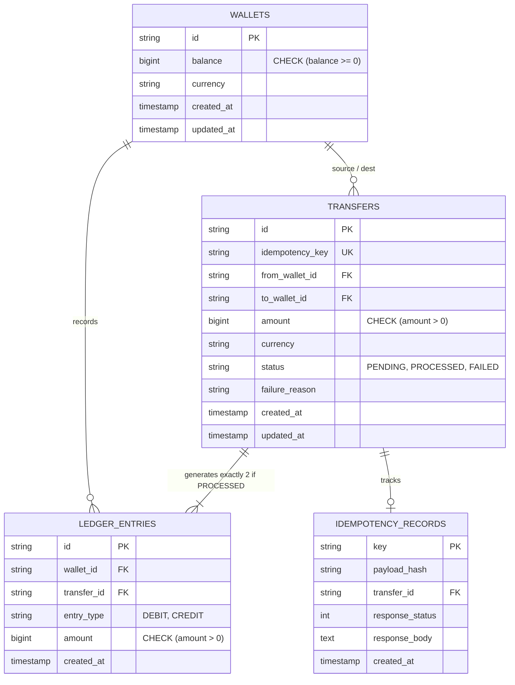

# Database Architecture & Schema Design

## 1. Entity-Relationship Overview



---

## 2. Table Specifications & Constraints

### 1. `wallets`
Stores the current balance state for low-latency balance lookups.
- `id` (VARCHAR PRIMARY KEY): Unique wallet identifier.
- `balance` (BIGINT NOT NULL): Balance represented in lowest denomination (e.g. cents).
  - **Constraint:** `CHECK (balance >= 0)` guarantees at the database engine level that no race condition or software bug can ever overdraft an account.
- `currency` (VARCHAR(3) NOT NULL): Currency code (e.g. `USD`).

### 2. `transfers`
Audit record of every initiated money movement.
- `id` (VARCHAR PRIMARY KEY): Unique UUIDv4 identifier.
- `idempotency_key` (VARCHAR NOT NULL UNIQUE): Unique constraint enforcing exactly-once processing.
- `from_wallet_id` (VARCHAR NOT NULL REFERENCES wallets(id)): Source wallet.
- `to_wallet_id` (VARCHAR NOT NULL REFERENCES wallets(id)): Destination wallet.
- `amount` (BIGINT NOT NULL): Must satisfy `CHECK (amount > 0)`.
- `status` (VARCHAR NOT NULL): Enforced via `CHECK (status IN ('PENDING', 'PROCESSED', 'FAILED'))`.
- `failure_reason` (TEXT): Stored when transfer enters `FAILED` state (e.g. `INSUFFICIENT_FUNDS`).

### 3. `ledger_entries`
Immutable double-entry bookkeeping ledger.
- `id` (VARCHAR PRIMARY KEY): Unique UUIDv4 entry identifier.
- `wallet_id` (VARCHAR NOT NULL REFERENCES wallets(id)): Affected wallet.
- `transfer_id` (VARCHAR NOT NULL REFERENCES transfers(id)): Associated transfer.
- `entry_type` (VARCHAR NOT NULL): Enforced via `CHECK (entry_type IN ('DEBIT', 'CREDIT'))`.
- `amount` (BIGINT NOT NULL): Stored as positive integer `CHECK (amount > 0)`.

**Double-Entry Invariant:**
Every `PROCESSED` transfer produces exactly two ledger rows:
1. One `DEBIT` entry for `from_wallet_id`.
2. One `CREDIT` entry for `to_wallet_id`.
The ledger always balances: $\sum \text{Credits} - \sum \text{Debits} = 0$.

### 4. `idempotency_records`
Stores deduplication state and pre-computed responses.
- `key` (VARCHAR PRIMARY KEY): Caller-supplied idempotency key.
- `payload_hash` (VARCHAR(64) NOT NULL): SHA-256 canonical hash of the request parameters.
- `transfer_id` (VARCHAR REFERENCES transfers(id)): Associated transfer ID.
- `response_status` (INT NOT NULL): HTTP status code (201 on success, 409 on persisted insufficient funds).
- `response_body` (TEXT NOT NULL): Cached response JSON payload for instant replay.

---

## 3. Database Indexes

To maintain high throughput and low query latency under load:
```sql
CREATE INDEX idx_transfers_from_wallet ON transfers(from_wallet_id);
CREATE INDEX idx_transfers_to_wallet ON transfers(to_wallet_id);
CREATE INDEX idx_transfers_created_at ON transfers(created_at);
CREATE INDEX idx_ledger_wallet_transfer ON ledger_entries(wallet_id, transfer_id);
CREATE INDEX idx_ledger_created_at ON ledger_entries(created_at);
```

---

## 4. Dual Storage Engine Design

- **PostgreSQL 16 (Production):** Uses ACID transactions, native `SELECT ... FOR UPDATE` row locks in sorted order, and database constraint error decoding (PostgreSQL error code `23505` for unique violations).
- **In-Memory Engine (Zero-Config Development):** Thread-safe Go map storage protected by mutex-serialized transactions (`txMu sync.Mutex` inside `ExecTx()`). Allows running and evaluating the complete system immediately without external software.
