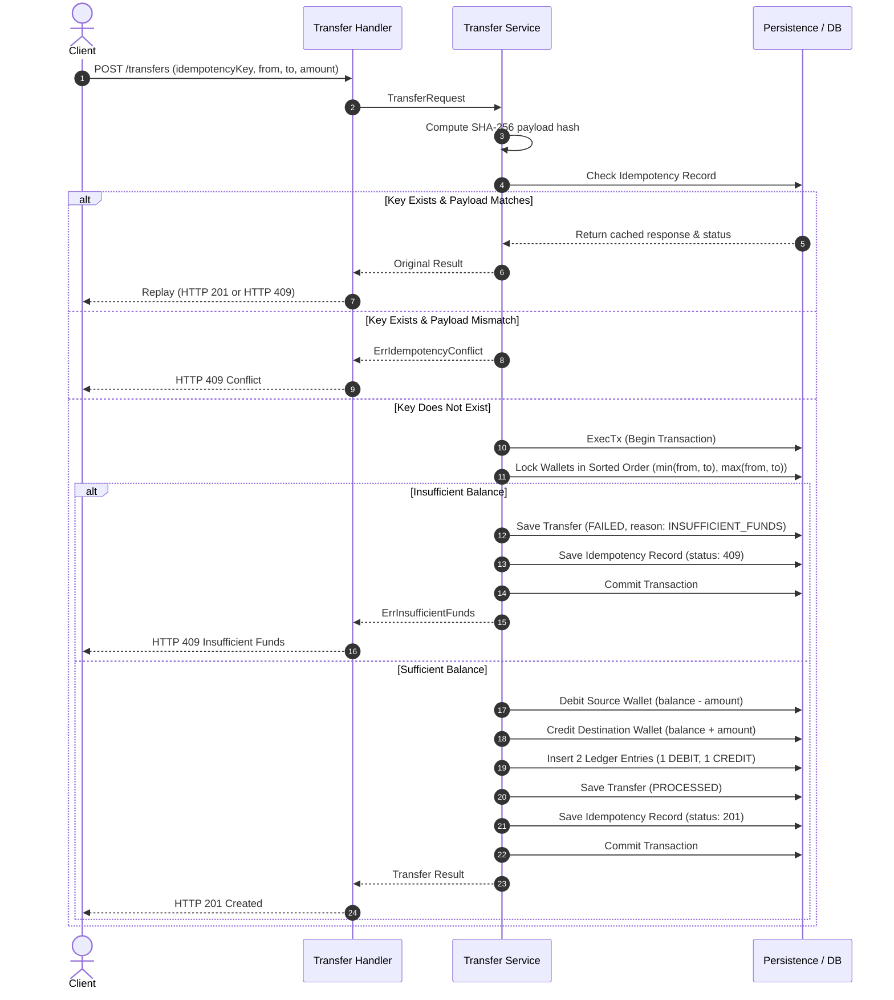

# Service Architecture & System Design

## 1. Overview & Clean Layered Architecture
The service is structured following Clean Layered Architecture principles. Each layer has strict responsibilities and unidirectional dependencies:

```
[ HTTP Transport Layer: Handlers & Middleware ]
                      │
                      ▼
[ Application Service Layer: Orchestration & Idempotency ]
                      │
                      ▼
[ Persistence Layer: Repository Interface (Postgres / Memory) ]
                      │
                      ▼
[ Core Domain Layer: Models, Invariants & Validation Rules ]
```

### Layer Responsibilities
- **`internal/handler/`**: Thin HTTP transport adapter. Parses JSON, maps incoming parameters, sets HTTP status headers, and serializes responses using standard envelopes. Never touches persistence directly.
- **`internal/service/`**: Core business orchestration. Owns transfer workflows, idempotency validation, payload hashing, deterministic wallet lock ordering, and ledger coordination.
- **`internal/repository/`**: Storage abstraction contract (`Repository` interface). Defines atomic transaction primitives (`ExecTx`) and entity lookups. Decoupled from SQL details.
- **`internal/model/`**: Pure Go domain logic. Enforces positive amounts, distinct sender/receiver IDs, state transitions (`PENDING -> PROCESSED` or `PENDING -> FAILED`), and typed sentinel errors (`ErrInsufficientFunds`, `ErrSelfTransfer`).

---

## 2. Transfer Execution Workflow

Every transfer executed through `POST /transfers` follows this strict transactional sequence:



---

## 3. Idempotency Guarantees
- **Canonical Request Fingerprint:** Computes `SHA-256(fromWalletId + "|" + toWalletId + "|" + amount + "|" + currency)`.
- **Zero-Side-Effect Replay:** When a duplicate key arrives with an identical fingerprint, the original response status code and JSON body are returned directly without touching wallet balances or generating ledger records.
- **Conflict Rejection:** If the same idempotency key is submitted with altered parameters (e.g., modified amount or different destination), the request is rejected with `HTTP 409 Conflict`.
- **Concurrent Race Resolution:** If two identical requests hit the service concurrently and both pass the initial lookup, database-level unique constraints reject the losing transaction. The losing thread catches the constraint error, rolls back, and replays the winner's committed response.

---

## 4. Deadlock-Free Concurrency Control
- **Problem:** When Request 1 transfers from Wallet A -> Wallet B and Request 2 transfers from Wallet B -> Wallet A simultaneously, locking Wallet A then B while the other locks B then A triggers a classic circular deadlock.
- **Solution:** Global Deterministic Lock Ordering:
  ```go
  firstID, secondID := fromWalletID, toWalletID
  if firstID > secondID {
      firstID, secondID = toWalletID, fromWalletID
  }
  ```
  Both threads acquire row locks in the exact same global order (`firstID` then `secondID`). Circular wait conditions are mathematically eliminated.
